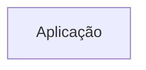
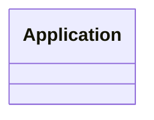
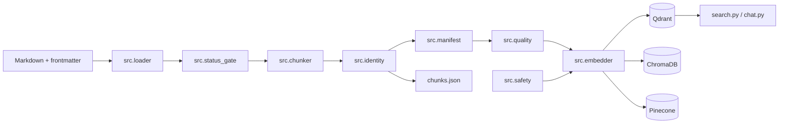

# Arquitetura

<!-- specsfy:documentator:start -->
## Componentes

| Tipo | Quantidade |
| --- | --- |
| Código | 0 |
| Testes | 0 |

## Diagramas

<!-- specsfy:documentator:end -->

## Arquitetura Python verificada

O pipeline é uma aplicação CLI modular em Python. `pipeline.py` compõe os
módulos; desde a SPEC-0003 a criação de providers e o acesso à persistência
vivem em `src/providers/`, atrás de contratos neutros e de uma factory, e
`src/indexing.py` traduz `config.yaml` e chunks para esses contratos. O antigo
`src/embedder.py`, lacuna registrada no BACKLOG-0003, foi removido.
Identidades determinísticas e manifesto sustentam idempotência e auditoria. O Qdrant implementa upsert antes da remoção
de obsoletos no mesmo `project_id`.

`src/quality.py`, introduzido pela SPEC-0006, acrescenta um segundo ponto de
bloqueio entre o manifesto e a indexação. Ele separa invariante determinístico,
que interrompe a execução, de sinal heurístico, que apenas entra no relatório;
somente o primeiro pode reprovar uma carga. O módulo é leitura pura e não
importa SDK de banco vetorial.

`src/safety.py` concentra a política fail-closed exigida antes de qualquer
mutação remota. `SyncSafetyPolicy` rejeita a opção `--recreate`, valida provider
e modo de sincronização, exige um único `project_id` sem `chunk_id` duplicado e
libera a remoção somente quando o destino confirma todos os pontos esperados.
Os entrypoints `pipeline.py` e `upsert_from_chunks.py` aplicam a guarda antes de
criar qualquer cliente.

`src/validation.py` estabelece a fronteira local da validação de recuperação:
ele lê e valida o gabarito versionado antes de compor ou consultar um adapter e,
só então, executa o preflight de ambiente — existência do escopo e dimensão
declarada pelo destino — por leitura pura, sem preparar a coleção. Aprovado o
preflight, ele resolve o manifesto pela mesma regra de `pipeline.py`, confirma
que ele descreve a base configurada e compara por igualdade estrita os
`chunk_id` previstos com os devolvidos por `list_ids`, separando faltantes de
órfãos. Por fim executa o gabarito da base, avaliando cada consulta pela
categoria declarada: ampla e específica pelos fatos de `deve_conter` e pelo
`documento_esperado`, e sem resposta pela ausência de resultado que alcance
`validacao.limiar_minimo`. O roteiro roda mesmo com a conferência divergente,
porque é leitura pura e o operador precisa do quadro completo. O resultado sai
em duas formas: um relatório legível na ordem em que a validação acontece e um
JSON em `output/<base>/validation-<run_id>.json`, com preflight, conferência,
consultas e desfecho, sem credencial, token ou URL de destino. O caminho do
arquivo fica fora do JSON de propósito, para que o gravado seja idêntico ao que
o módulo devolve a quem o chama sem a linha de comando.

Para conferir o destino sem alterá-lo, o contrato neutro expõe
`VectorStoreAdapter.describe_scope(scope)`, acrescentado pela SPEC-0004. A
operação é leitura pura: devolve existência e dimensão declaradas pelo destino,
ou um mapa vazio quando o escopo não existe. Ela existe porque `ensure_ready`
prepara o destino e cria a coleção ausente, o que uma validação somente leitura
não pode fazer. Cada backend a implementa com a leitura própria do seu SDK —
`get_collection` no Qdrant, cliente direto do ChromaDB em vez do construtor que
faz get-or-create, `describe_index` no Pinecone — e o backend em memória serve
de referência.

O contrato de recepção de Markdown do projeto-mãe (SPEC-0002) estende esse
desenho em quatro pontos: `document_id` do frontmatter tem precedência sobre a
identidade determinística (`src/identity.py`); `SyncSafetyPolicy.assert_valid_scope`
passou a validar e retornar também `tenant_id`, estendendo o escopo lógico
fail-closed para `project_id + tenant_id`; `src/status_gate.py` exclui, antes
do chunking, documentos com `status` presente em uma lista bloqueante
configurável (`contrato_markdown.status_bloqueado` em `config.yaml`); e
`src/chunker.py` ganhou o splitter `qa`, que divide o corpo por `++++` em um
chunk por bloco quando o documento declara `splitter: qa` no frontmatter.
`type` e `version` do frontmatter são propagados a cada chunk pelo mecanismo
de mesclagem de metadata já existente, sem efeito no processamento.
