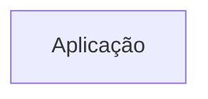
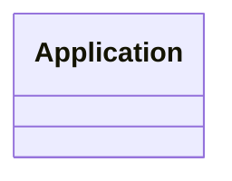
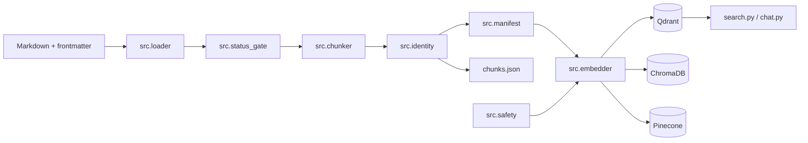

# Arquitetura

<!-- specsfy:documentator:start -->
## Componentes

| Tipo | Quantidade |
| --- | --- |
| Código | 0 |
| Testes | 0 |

## Diagramas

<!-- specsfy:documentator:end -->

## Arquitetura Python verificada

O pipeline é uma aplicação CLI modular em Python. `pipeline.py` compõe os
módulos; `src/embedder.py` ainda concentra criação de providers e persistência,
lacuna registrada no BACKLOG-0003. Identidades determinísticas e manifesto
sustentam idempotência e auditoria. O Qdrant implementa upsert antes da remoção
de obsoletos no mesmo `project_id`.

`src/safety.py` concentra a política fail-closed exigida antes de qualquer
mutação remota. `SyncSafetyPolicy` rejeita a opção `--recreate`, valida provider
e modo de sincronização, exige um único `project_id` sem `chunk_id` duplicado e
libera a remoção somente quando o destino confirma todos os pontos esperados.
Os entrypoints `pipeline.py` e `upsert_from_chunks.py` aplicam a guarda antes de
criar qualquer cliente.

O contrato de recepção de Markdown do projeto-mãe (SPEC-0002) estende esse
desenho em quatro pontos: `document_id` do frontmatter tem precedência sobre a
identidade determinística (`src/identity.py`); `SyncSafetyPolicy.assert_valid_scope`
passou a validar e retornar também `tenant_id`, estendendo o escopo lógico
fail-closed para `project_id + tenant_id`; `src/status_gate.py` exclui, antes
do chunking, documentos com `status` presente em uma lista bloqueante
configurável (`contrato_markdown.status_bloqueado` em `config.yaml`); e
`src/chunker.py` ganhou o splitter `qa`, que divide o corpo por `++++` em um
chunk por bloco quando o documento declara `splitter: qa` no frontmatter.
`type` e `version` do frontmatter são propagados a cada chunk pelo mecanismo
de mesclagem de metadata já existente, sem efeito no processamento.
