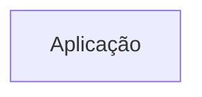
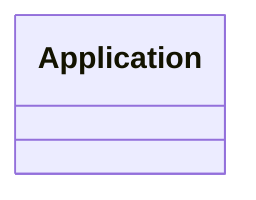
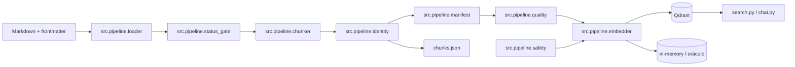
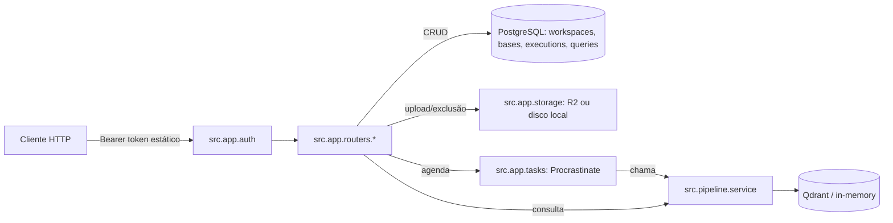

# Arquitetura

<!-- specsfy:documentator:start -->
## Componentes

| Tipo | Quantidade |
| --- | --- |
| Código | 364 |
| Testes | 21 |

## Diagramas

<!-- specsfy:documentator:end -->

## Contrato da fronteira entre aplicação e pipeline

O pacote `src/app/` é o destino da camada de aplicação. Ele pode depender
somente da fachada síncrona em `src/pipeline/service.py`; importar qualquer
outro módulo de `src/pipeline/` é uma violação verificada por AST em
`tests/test_application_boundaries.py`. A dependência inversa também é
proibida: o pipeline não importa `src.app`.

A fachada recebe por parâmetro um dicionário de configuração não sensível já
resolvido. Ela não abre `config.yaml`, não consulta o ambiente para essa
configuração e não recebe credenciais em suas assinaturas. A resolução de
credenciais continua encapsulada nos providers. As operações são síncronas e
bloqueiam a thread chamadora; uma camada HTTP ou de jobs deverá executá-las fora
da thread de requisição quando precisar de assincronia.

| Operação pública | Entrada principal | Resultado |
| --- | --- | --- |
| `run_pipeline` | configuração, diretório de entrada opcional e modo somente chunks | documentos, chunks, manifesto, relatório de qualidade e contagens opcionais |
| `sync_vector_store` | configuração e sequência de chunks | `SyncCounts` com `previstos`, `inseridos`, `mantidos` e `removidos` |
| `validate_retrieval` | configuração e `tenant_id` opcional | `ValidationReport` com veredito, conferência e consultas |
| `query_base` | configuração, consulta, `top_k` e `tenant_id` opcional | resultados neutros com conteúdo, metadados e score |
| `delete_scope` | configuração e `tenant_id` opcional | quantidade de pontos removidos do escopo lógico configurado (SPEC-0012, backend de aplicação: usada por `DELETE /api/v1/bases/{id}` para esvaziar o vector store de uma base) |

Os adaptadores de linha de comando permanecem na raiz e continuam responsáveis
por resolver `config.yaml`: `pipeline.py`, `search.py`, `chat.py`, `validate.py`
e `upsert_from_chunks.py`. Eles preservam os argumentos existentes e delegam à
operação correspondente da fachada.

### Carga do ambiente pelos entrypoints

Desde a SPEC-0009, `src/bootstrap.py` expõe `load_env()` e é o ponto único de
carga do arquivo `.env`. Cada entrypoint `.py` da raiz — os cinco comandos de
operação mais `main.py`, `demo_rag.py`, `inspect_chunks.py` e `quality.py` —
chama `load_env()` como primeira ação de `main()`, antes de resolver
`config.yaml`. `load_env()` é idempotente, não sobrescreve variável já presente
no ambiente e não levanta erro quando não há `.env`.

Nenhum módulo sob `src/pipeline/` importa `python-dotenv` nem chama
`load_dotenv`; a biblioteca apenas lê variáveis já presentes no ambiente, e a
resolução de credenciais permanece nos providers. Duas varreduras estáticas em
`tests/test_env_bootstrap.py` reprovam import de `dotenv` em `src/pipeline/` e
entrypoint da raiz sem `load_env()`, nomeando o arquivo.

### Limites e dívidas bloqueantes

- `BACKLOG-0012` foi **resolvido** pela SPEC-0009: a carga do `.env` saiu do
  import de `src/pipeline/config.py` e passou a `src/bootstrap.py`, chamado
  pelos entrypoints da raiz. A regra de configuração injetada da SPEC-0008
  deixa de ser contornável por efeito colateral de import.
- `BACKLOG-0013` foi **resolvido** pela SPEC-0011: o comportamento dos
  backends reais de vector store ganhou cobertura própria, destravando a
  incorporação do backend de aplicação. Enquanto esteve aberto, prosseguir com
  a fatia de backend teria exigido reabrir a SPEC-0008; a resolução do
  BACKLOG-0013 eliminou essa necessidade antes de a SPEC-0012 começar.
- A SPEC-0012 entregou a fatia 2 do BACKLOG-0008: um backend FastAPI em
  `src/app/` (ver seção "Backend de aplicação (SPEC-0012)" abaixo), consumindo
  exclusivamente a fachada `src/pipeline/service.py`.

### Baseline de regressão

A migração da SPEC-0008 usou como baseline mínima os 238 testes registrados na
sua definição. Depois dela a suíte chegou a 255 testes aprovados, que passam a
ser a **baseline mínima da SPEC-0009**: a entrega não pode reduzir essa
contagem e deve manter `uv run ruff check .` sem achados.

A **SPEC-0010** é a exceção autorizada em que a baseline **diminui**: a remoção
de ChromaDB e Pinecone eliminou as suítes de conformidade parametrizadas sobre
esses dois providers (`test_vectorstore_conformance.py`,
`test_describe_scope_*`, `test_safety.py`, `test_safety_policy.py`,
`test_provider_factory.py`) e os casos `describe` dedicados, ao mesmo tempo em
que acrescentou 14 casos próprios em `tests/test_provider_removal.py` e nas
suítes existentes. A nova **baseline mínima da SPEC-0010 é de 248 testes
aprovados**, com `uv run ruff check .` sem achados. A redução decorre
exclusivamente da remoção autorizada de Chroma e Pinecone (DEC-001, DEC-004),
não de perda de cobertura de comportamento: cada garantia dos providers
removidos que ainda se aplica ao projeto Qdrant-only continua provada.

A SPEC-0011 (backends reais de vector store) e a SPEC-0012 (backend de
aplicação) acrescentaram casos próprios sem remover nenhum existente. A
**baseline mínima atual é de 281 testes aprovados**, com `uv run ruff check .`
sem achados. Os testes de `src/app/` (SPEC-0012) exigem um PostgreSQL de teste
acessível via `APP_DATABASE_URL` — ver `.specsfy/STACK.md`.

### Como adicionar um provider de vector store

A abstração multi-provider permanece aberta. Para introduzir um novo destino:

1. criar `src/pipeline/providers/vectorstores/<nome>.py` com um adapter que
   estenda `BaseVectorStoreAdapter` (e `MirrorMixin` quando comprovar a
   garantia de escopo do modo espelho) e um backend port sobre o SDK, com
   cliente lazy em `_conn()`;
2. registrar `"<nome>": ("src.pipeline.providers.vectorstores.<nome>", "<Classe>")`
   em `ProviderFactory._VECTOR_STORES`; acrescentar `"<nome>"` a
   `_REAL_PROVIDERS` (`base.py`) e a `SyncSafetyPolicy._SUPPORTED_PROVIDERS`
   (e `_MIRROR_PROVIDERS` se aplicável);
3. incluir `"<nome>"` nas tuplas de parametrização da suíte de conformidade
   (`tests/test_vectorstore_conformance.py`, `tests/test_describe_scope_conformance.py`).

Nenhuma dessas etapas altera `contracts.py` nem a superfície pública da
`ProviderFactory`.

## Arquitetura Python verificada

O pipeline é uma aplicação CLI modular em Python. `pipeline.py` compõe os
módulos; desde a SPEC-0003 a criação de providers e o acesso à persistência
vivem em `src/pipeline/providers/`, atrás de contratos neutros e de uma factory, e
`src/pipeline/indexing.py` traduz `config.yaml` e chunks para esses contratos. O antigo
`src/pipeline/embedder.py`, lacuna registrada no BACKLOG-0003, foi removido.
Identidades determinísticas e manifesto sustentam idempotência e auditoria. O Qdrant implementa upsert antes da remoção
de obsoletos no mesmo `project_id`.

`src/pipeline/quality.py`, introduzido pela SPEC-0006, acrescenta um segundo ponto de
bloqueio entre o manifesto e a indexação. Ele separa invariante determinístico,
que interrompe a execução, de sinal heurístico, que apenas entra no relatório;
somente o primeiro pode reprovar uma carga. O módulo é leitura pura e não
importa SDK de banco vetorial.

`src/pipeline/safety.py` concentra a política fail-closed exigida antes de qualquer
mutação remota. `SyncSafetyPolicy` rejeita a opção `--recreate`, valida provider
e modo de sincronização, exige um único `project_id` sem `chunk_id` duplicado e
libera a remoção somente quando o destino confirma todos os pontos esperados.
Os entrypoints `pipeline.py` e `upsert_from_chunks.py` aplicam a guarda antes de
criar qualquer cliente.

`src/pipeline/validation.py` estabelece a fronteira local da validação de recuperação:
ele lê e valida o gabarito versionado antes de compor ou consultar um adapter e,
só então, executa o preflight de ambiente — existência do escopo e dimensão
declarada pelo destino — por leitura pura, sem preparar a coleção. Aprovado o
preflight, ele resolve o manifesto pela mesma regra de `pipeline.py`, confirma
que ele descreve a base configurada e compara por igualdade estrita os
`chunk_id` previstos com os devolvidos por `list_ids`, separando faltantes de
órfãos. Por fim executa o gabarito da base, avaliando cada consulta pela
categoria declarada: ampla e específica pelos fatos de `deve_conter` e pelo
`documento_esperado`, e sem resposta pela ausência de resultado que alcance
`validacao.limiar_minimo`. O roteiro roda mesmo com a conferência divergente,
porque é leitura pura e o operador precisa do quadro completo. O resultado sai
em duas formas: um relatório legível na ordem em que a validação acontece e um
JSON em `output/<base>/validation-<run_id>.json`, com preflight, conferência,
consultas e desfecho, sem credencial, token ou URL de destino. O caminho do
arquivo fica fora do JSON de propósito, para que o gravado seja idêntico ao que
o módulo devolve a quem o chama sem a linha de comando.

Para conferir o destino sem alterá-lo, o contrato neutro expõe
`VectorStoreAdapter.describe_scope(scope)`, acrescentado pela SPEC-0004. A
operação é leitura pura: devolve existência e dimensão declaradas pelo destino,
ou um mapa vazio quando o escopo não existe. Ela existe porque `ensure_ready`
prepara o destino e cria a coleção ausente, o que uma validação somente leitura
não pode fazer. Cada backend a implementa com a leitura própria do seu SDK —
`get_collection` no Qdrant — e o backend em memória serve de referência.

O contrato de recepção de Markdown do projeto-mãe (SPEC-0002) estende esse
desenho em quatro pontos: `document_id` do frontmatter tem precedência sobre a
identidade determinística (`src/pipeline/identity.py`); `SyncSafetyPolicy.assert_valid_scope`
passou a validar e retornar também `tenant_id`, estendendo o escopo lógico
fail-closed para `project_id + tenant_id`; `src/pipeline/status_gate.py` exclui, antes
do chunking, documentos com `status` presente em uma lista bloqueante
configurável (`contrato_markdown.status_bloqueado` em `config.yaml`); e
`src/pipeline/chunker.py` ganhou o splitter `qa`, que divide o corpo por `++++` em um
chunk por bloco quando o documento declara `splitter: qa` no frontmatter.
`type` e `version` do frontmatter são propagados a cada chunk pelo mecanismo
de mesclagem de metadata já existente, sem efeito no processamento.

## Backend de aplicação (SPEC-0012)

`src/app/main.py` é o entrypoint FastAPI, com o mesmo papel que os CLIs da
raiz cumprem para o pipeline: é o único módulo que lê variável de ambiente
(`APP_DATABASE_URL`, `APP_EMBEDDING_*`, `APP_VECTOR_STORE_*`, `APP_R2_*`,
`APP_LOCAL_STORAGE_DIR`) e injeta a configuração resolvida em `src/app/db.py`,
`src/app/settings.py`, `src/app/storage.py` e `src/app/auth.py`. Nenhum outro
módulo de `src/app/` lê `os.environ` ou `config.yaml` diretamente.

- `src/app/auth.py`: token estático de demonstração (DEC-002, SPEC-0012) —
  não é o modelo final de autenticação — resolve `tenant_id`, `project_id` e
  `role` (`owner`/`admin`/`member`) a partir do cabeçalho `Authorization`.
  Rejeita antes de qualquer acesso a pipeline, banco ou storage.
- `src/app/db.py` e `src/app/models.py`: SQLAlchemy sobre PostgreSQL; modelos
  `workspaces`, `bases`, `executions` e `queries`. A SPEC-0019 tornou
  `Base.workspace_id` e `Base.collection_name` obrigatórios e adicionou o JSON
  `Base.metadados_chunk`; a revisão Alembic `0019_workspaces` materializa os
  campos e retroalimenta Bases legadas (ver `.specsfy/DATABASE.md`).
- `src/app/repo.py`: leituras com isolamento por tenant/projeto — Workspace,
  Base ou Execução de outro tenant/projeto é tratada como inexistente (404).
  Também concentra listagem de Workspaces e a consulta que bloqueia sua
  exclusão enquanto houver Base ativa.
- `src/app/storage.py`: `LocalDirectoryStorage` (padrão fora de produção) ou
  `S3CompatibleStorage` (Cloudflare R2), escolhidos por variável de ambiente.
- `src/app/tasks.py`: tarefa Procrastinate `process_base_task`, que materializa
  os arquivos da base, monta a configuração da fachada e chama
  `service.run_pipeline(..., only_chunks=True)`, mescla nos `Document.metadata`
  os pares persistidos na Base sem sobrescrever identidade/escopo estrutural e
  só então chama `service.sync_vector_store`. Só uma execução
  `pending`/`running` por base é permitida por vez (FR-009). A regra fica na
  camada de aplicação; `src/pipeline/` continua neutro em relação a Workspace.
- `src/app/routers/`: `workspaces.py` (CRUD escopado e exclusão lógica),
  `bases.py` (upload/base preparada obrigatoriamente vinculados a Workspace,
  coleção por Base, pares de metadados validados, filtro por Workspace e
  exclusão),
  `executions.py` (iniciar, consultar, repetir) e `queries.py` (consulta de
  validação sobre `service.query_base`).

Execução e consulta compõem uma cópia de `AppSettings.vector_store` e
substituem nela somente `collection_name` pelo valor persistido na Base. A
configuração global injetada permanece imutável, e duas Bases podem usar
coleções diferentes ou compartilhar uma coleção sem compartilhar seu
`scope_project_id`.

O worker que processa `process_base_task` não roda em um processo separado
nesta fatia; produção exigirá um comando de worker Procrastinate próprio,
compartilhando a mesma configuração de `src/app/main.py`. A suíte de testes
não exercita a conclusão real de uma tarefa (nenhum teste depende do worker
rodar); ela prova apenas o agendamento não bloqueante (FR-001) e as regras de
estado/permissão em torno dele.
