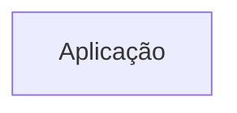
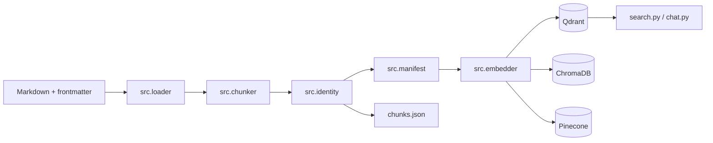

# Arquitetura

<!-- specsfy:documentator:start -->
## Componentes

| Tipo | Quantidade |
| --- | --- |
| Código | 0 |
| Testes | 0 |

## Diagramas

<!-- specsfy:documentator:end -->

## Arquitetura Python verificada

O pipeline é uma aplicação CLI modular em Python. `pipeline.py` compõe os
módulos; `src/embedder.py` ainda concentra criação de providers e persistência,
lacuna registrada no BACKLOG-0003. Identidades determinísticas e manifesto
sustentam idempotência e auditoria. O Qdrant implementa upsert antes da remoção
de obsoletos no mesmo `project_id`.
