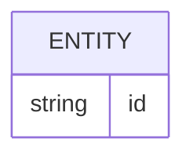
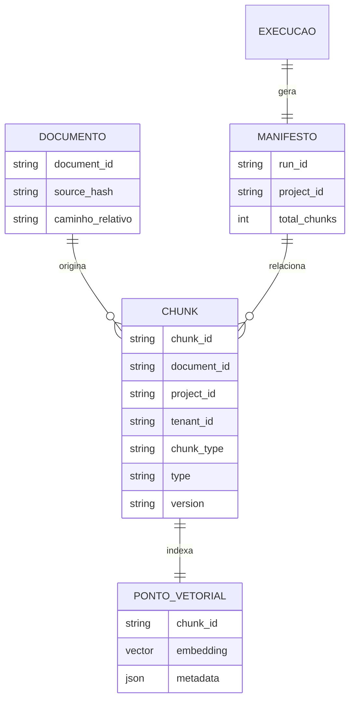
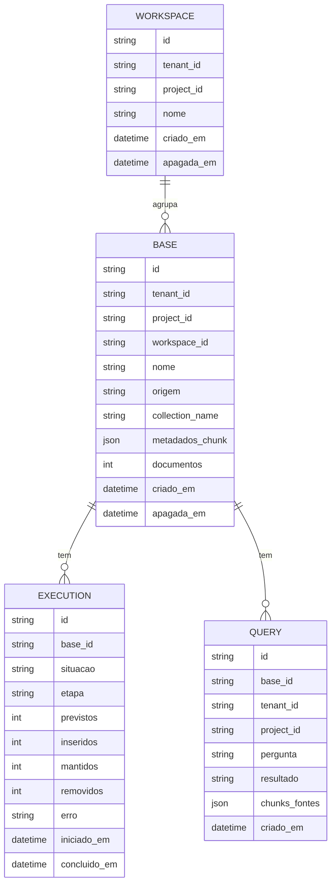

# Banco de dados

<!-- specsfy:documentator:start -->
## Fontes de persistência

| Arquivo |
| --- |
| .agents/skills/vercel-optimize/lib/scanners/prisma-include-tree.mjs |
| specs/inbox/2026-10-08-220019-stack-local-divergente-dos-arquivos-de-deploy-e-banco-sem-historico-de-migrations.md |
| tests/__pycache__/test_app_migrations.cpython-312-pytest-9.1.1.pyc |
| tests/test_app_migrations.py |
| Nenhuma estrutura confirmada além das fontes listadas. |

<!-- specsfy:documentator:end -->

## Persistência verificada do componente

As fontes persistentes são os Markdown de entrada, `chunks.json`, o manifesto
JSON e o destino vetorial Qdrant (único provider concreto desde a SPEC-0010).
O contrato completo e suas evidências permanecem em `.specsfy/DATABASE.md`.

Na SPEC-0042, `alembic upgrade head` prepara também a fila Procrastinate pela
revisão `0042_schema_da_fila`, filha de `0040_grupos_e_tabelas`. A migration usa
o SQL de `SchemaManager` pela mesma conexão e só o aplica quando
`to_regclass('procrastinate_jobs')` é nulo; repetir o upgrade preserva o schema.
O inventário das quatro tabelas `procrastinate_*` e de `alembic_version` fica em
`.specsfy/DATABASE.md`. Backend e worker consultam apenas a revisão na subida.
Para adoção de bancos legados, consulte a conferência prévia do schema completo
do app e da fila em `deploy/RUNBOOK.md` antes de usar `alembic stamp head`.

Desde o SPEC-0002, `document_id` recebido no frontmatter prevalece sobre a
identidade determinística, e `tenant_id` (opcional) estende o escopo lógico de
sincronização junto com `project_id`. `status` bloqueia a indexação por lista
configurável; `type` e `version` são metadado de auditoria sem efeito no
processamento.

## Persistência do backend de aplicação (SPEC-0012 e SPEC-0019)

PostgreSQL, via SQLAlchemy (`src/app/models.py`) e Alembic para migrações. O
modelo da SPEC-0019 declara que toda `BASE` pertence obrigatoriamente a um
`WORKSPACE`, escolhe sua própria `collection_name` e persiste uma lista JSON
de pares de metadados por chunk. A revisão que cria e retroalimenta o schema é
`0019_workspaces`: ela parte de `4d0fd0aa498e`, cria um Workspace padrão por
tenant/projeto, preserva a coleção global das Bases legadas e torna as duas
referências obrigatórias após o backfill. O downgrade mantém as linhas de
`BASE`, `EXECUTION` e `QUERY`.
Apagar uma `BASE` remove suas `EXECUTION` e `QUERY`, os arquivos no storage
(R2 ou disco local) e os vetores associados no vector store (na coleção e na conexão Qdrant da própria Base; coleção já ausente conta como apagada), preservando
apenas `apagada_em` preenchido e `nome` esvaziado como registro mínimo da
exclusão. Detalhes e evidências em `.specsfy/DATABASE.md`.
