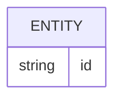
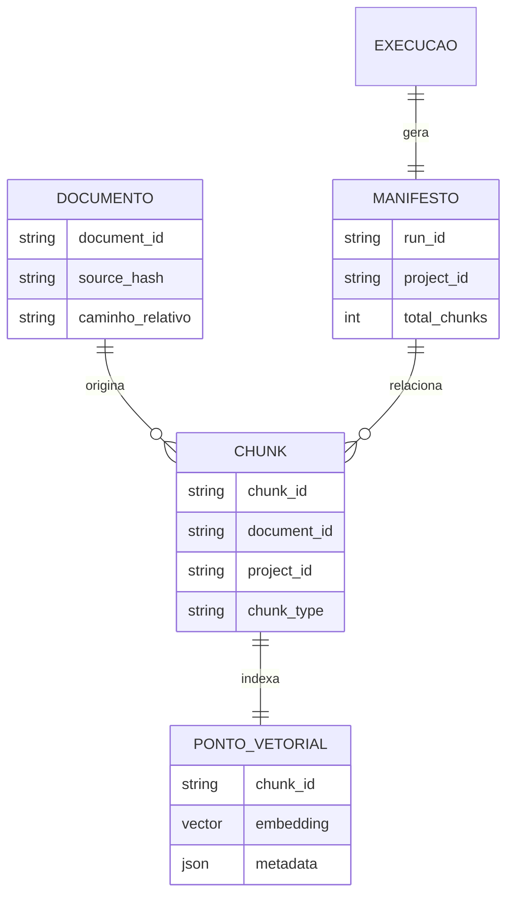

# Banco de dados

<!-- specsfy:documentator:start -->
## Fontes de persistência

| Arquivo |
| --- |
| Nenhuma estrutura confirmada além das fontes listadas. |

<!-- specsfy:documentator:end -->

## Persistência verificada do componente

As fontes persistentes são os Markdown de entrada, `chunks.json`, o manifesto
JSON e os destinos vetoriais Qdrant, ChromaDB ou Pinecone. O contrato completo
e suas evidências permanecem em `.specsfy/DATABASE.md`.
