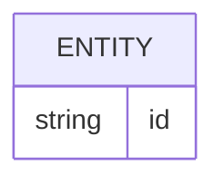
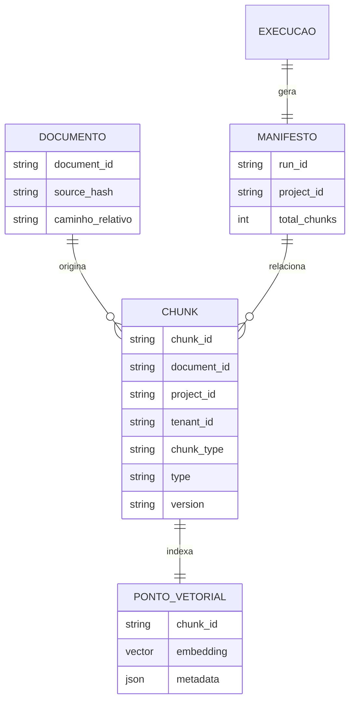
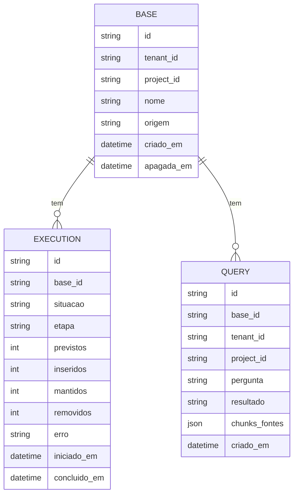

# Banco de dados

<!-- specsfy:documentator:start -->
## Fontes de persistência

| Arquivo |
| --- |
| Nenhuma estrutura confirmada além das fontes listadas. |

<!-- specsfy:documentator:end -->

## Persistência verificada do componente

As fontes persistentes são os Markdown de entrada, `chunks.json`, o manifesto
JSON e o destino vetorial Qdrant (único provider concreto desde a SPEC-0010).
O contrato completo e suas evidências permanecem em `.specsfy/DATABASE.md`.

Desde o SPEC-0002, `document_id` recebido no frontmatter prevalece sobre a
identidade determinística, e `tenant_id` (opcional) estende o escopo lógico de
sincronização junto com `project_id`. `status` bloqueia a indexação por lista
configurável; `type` e `version` são metadado de auditoria sem efeito no
processamento.

## Persistência do backend de aplicação (SPEC-0012)

PostgreSQL, via SQLAlchemy (`src/app/models.py`) e Alembic para migrações.
Apagar uma `BASE` remove suas `EXECUTION` e `QUERY`, os arquivos no storage
(R2 ou disco local) e os vetores associados no vector store, preservando
apenas `apagada_em` preenchido e `nome` esvaziado como registro mínimo da
exclusão. Detalhes e evidências em `.specsfy/DATABASE.md`.
