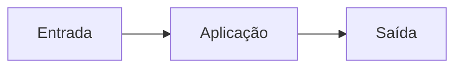
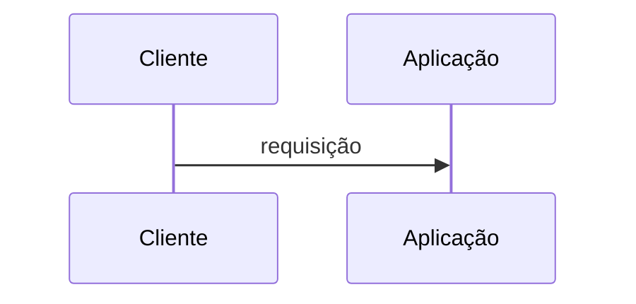
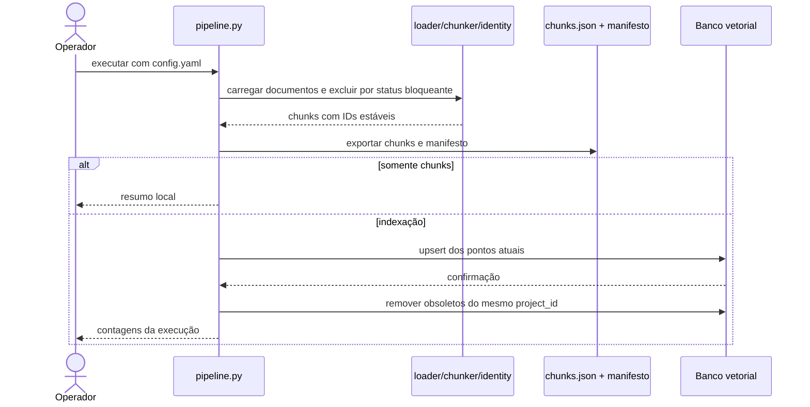
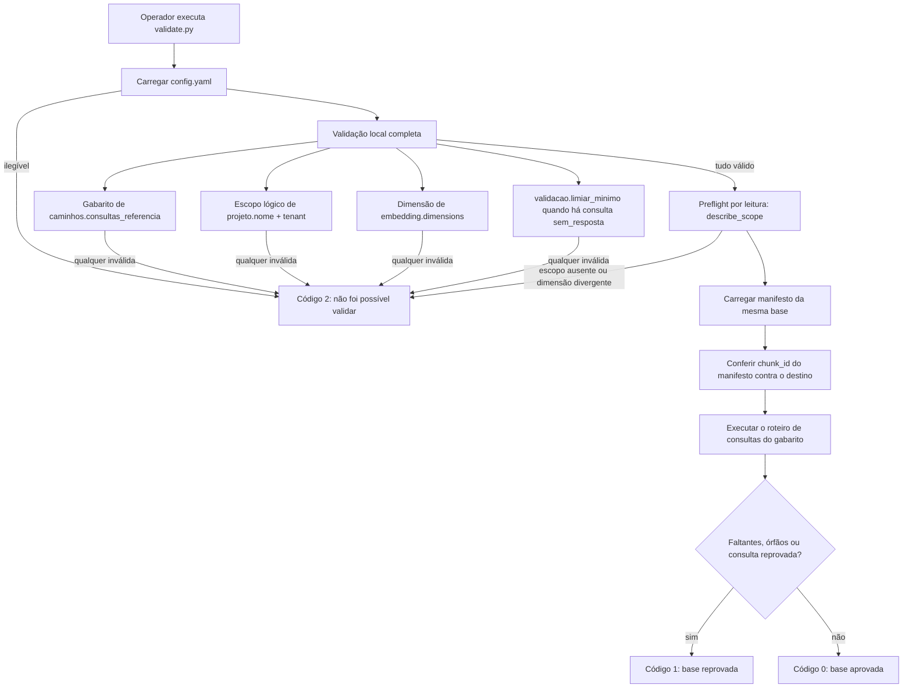

# Fluxos

<!-- specsfy:documentator:start -->
## Fluxo principal

<!-- specsfy:documentator:end -->

## Fluxo CLI verificado

Falhas de carga em modo estrito e falhas de upsert interrompem o fluxo. A
remoção de obsoletos no Qdrant somente ocorre depois de upsert bem-sucedido.

Antes de qualquer chamada remota, `src.safety.SyncSafetyPolicy` interrompe a
execução quando `--recreate` é solicitado, quando provider e modo são
incompatíveis ou quando o lote não forma um escopo lógico único. A remoção de
obsoletos exige confirmação prévia de todos os pontos esperados; sem essa
confirmação, o fluxo falha e preserva os dados remotos.

## Fluxo de validação verificado

`validate.py` é somente leitura: nenhum caminho de execução, inclusive os de
falha, envia escrita, remoção ou preparação ao destino. Ele nunca usa
`ensure_ready`, porque aquele caminho cria a coleção ausente no adapter Qdrant e
transformaria um escopo inexistente em base vazia aprovada.

Ordem e garantias observadas em `src/validation.py`:

1. **Toda a validação local precede qualquer acesso remoto.** Configuração
   incompleta ou gabarito malformado encerram com código `2` sem que um adapter
   chegue a ser criado.
2. **O preflight é leitura pura.** `describe_scope` confere existência do escopo
   e compatibilidade com `embedding.dimensions`.
3. **A conferência de identidade exige igualdade estrita** entre o conjunto de
   `chunk_id` do manifesto e o devolvido pelo destino, relatando faltantes e
   órfãos separadamente.
4. **O roteiro de consultas roda mesmo com a conferência divergente**, de
   propósito: é leitura pura e o operador precisa do quadro completo para
   decidir o que corrigir, em vez de descobrir um problema por vez.
5. **Impedimento não é reprovação.** Código `2` significa que não foi possível
   validar; código `1` significa que a validação ocorreu e encontrou
   divergência.

Relatório, JSON e log não contêm credenciais, tokens nem URLs de destino. O
resultado estruturado é gravado em `output/<base>/validation-<run_id>.json`.
