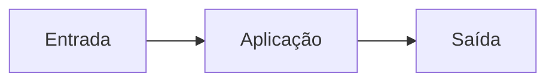
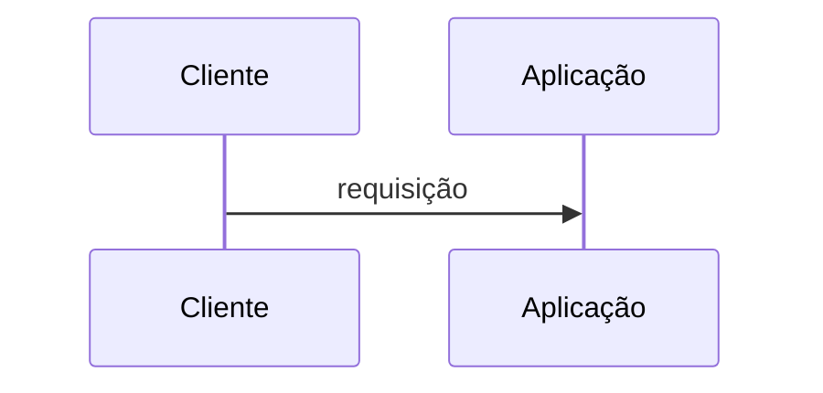
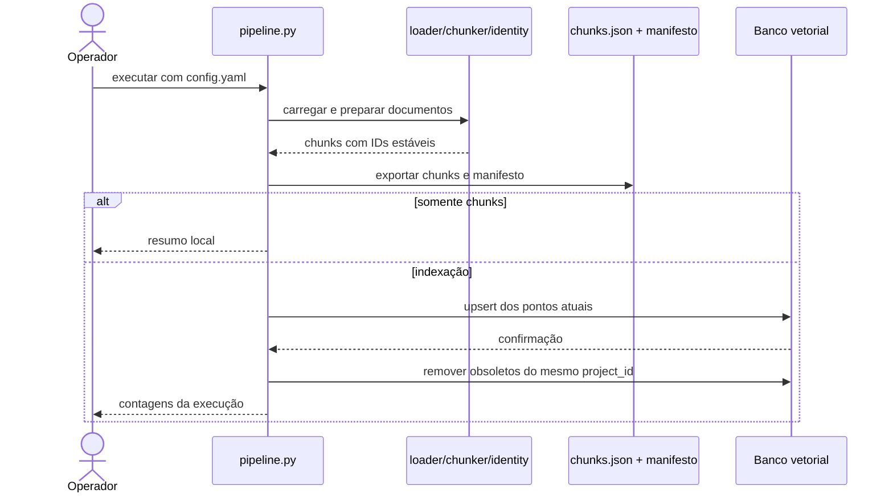

# Fluxos

<!-- specsfy:documentator:start -->
## Fluxo principal

<!-- specsfy:documentator:end -->

## Fluxo CLI verificado

Falhas de carga em modo estrito e falhas de upsert interrompem o fluxo. A
remoção de obsoletos no Qdrant somente ocorre depois de upsert bem-sucedido.
